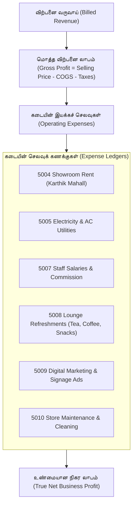
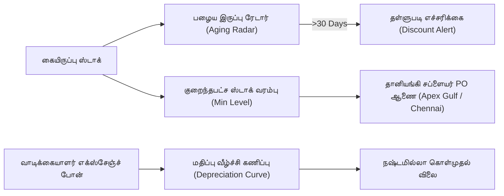

# SASAN THE GADGET LOUNGE — THE DECADE ARCHITECTURE BLUEPRINT (2026–2036)
## அடுத்த பத்தாண்டுகளுக்கான உன்னத Enterprise Retail ERP கட்டமைப்பு: அ முதல் அஃ வரை

> **நிறுவனம்:** Sasan The Gadget Lounge  
> **முகவரி:** 106/7, Karthik Mahall, Subban St, Theni, Tamil Nadu - 625531  
> **இயற்கை:** பிரீமியம் ஸ்மார்ட்போன்கள், லேப்டாப்கள், ஆடியோ கேட்ஜெட்டுகள் & GST Rule 32(5) Pre-Owned Margin Scheme  
> **ஆவண நோக்கம்:** இந்நிறுவனத்தின் அனைத்து தேவைகளையும் பூர்த்தி செய்து, அடுத்த 10 ஆண்டுகளுக்கு வேறெந்த மென்பொருளையும் நாடத் தேவையின்றி உலகின் தலைசிறந்த ஒரே மென்பொருளாக நிலைநிறுத்துவதற்கான விரிவான வழிகாட்டி.

---

## 1. செயல்முறை முக்கால பில்லிங் மேலாண்மை (Tri-Temporal Billing Matrix)

```mermaid
flowchart LR
    subgraph PAST["கடந்த காலம் (Past)"]
        P1["Backdated Retro-Billing"]
        P2["Excel/Tally Historic Migration"]
        P3["Past Period Tax Re-calculation"]
    end

    subgraph PRESENT["நிகழ் காலம் (Present)"]
        PR1["NFC / UHF RFID 2-Sec Checkout"]
        PR2["5-Way Split Payment Engine"]
        PR3["12 Dual-Mode Vector Templates"]
    end

    subgraph FUTURE["எதிர்காலம் (Future)"]
        F1["Flagship Pre-booking Token Advance"]
        F2["Quotation / Estimate Dockets"]
        F3["Auto-Conversion to Tax Invoice on Arrival"]
    end

    PAST --> PRESENT --> FUTURE
```

### அ. கடந்த காலம் (Past / Historical Retro-Billing)
- **பழைய தேதியிட்ட பில் பதிவுகள் (Backdated Invoicing):** முந்தைய தேதிகளில் விடுபட்ட பில்களை அந்த குறிப்பிட்ட நாளின் வரிச் சட்டம் மற்றும் மார்ஜின் விகிதங்களின்படி துல்லியமாகப் பதிதல்.
- **வரலாற்று தரவு இறக்குமதி (1-Click Historic Migration):** முந்தைய ஆண்டுகளில் வேறு மென்பொருளிலோ அல்லது எக்செல் தாள்களிலோ பராமரித்த பழைய வாடிக்கையாளர் மற்றும் பில்லிங் தரவுகளை முழுமையாக EF Core SQLite டேட்டாபேஸில் இறக்குமதி செய்தல்.

### ஆ. நிகழ் காலம் (Present / Zero-Latency POS & Wireless Tap)
- **வயர்லெஸ் செக்-அவுட் (NFC Proximity & UHF RFID Radar):** மொபைல் சாதனத்தை கவுண்டரில் உள்ள ரீடரில் தட்டிய 1 விநாடியில் பில் கார்ட்டில் ஏற்றி, 10 விநாடிகளில் A4 அல்லது 80mm தர்மல் பிரிண்ட் வழங்குதல்.
- **5-பிரிவு பணப் பரிவர்த்தனை (Complex Tender Split):** கல்லா ரொக்கம், கூகுள்பே/போன்பே UPI, EDC கார்டு மெஷின், பழைய போன் எக்ஸ்சேஞ்ச் கழிவு, பஜாஜ்/HDB EMI ஆகியவற்றை ஒரே பில்லில் துல்லியமாகப் பிரித்து கணக்கு வைத்தல்.

### இ. எதிர்காலம் (Future / Pre-Orders, Advance Booking & Quotations)
- **முன்பதிவு டோக்கன் பில் (Advance Token Receipt):** அடுத்த வாரம் வரவிருக்கும் புதிய ஐபோன் அல்லது சாம்சங் அல்ட்ரா போன்களுக்கு வாடிக்கையாளர் செலுத்தும் முன்பணத்தை (Advance ₹5,000 / ₹10,000) முறையாகப் பதிவு செய்து ரசீது தருதல்.
- **தானியங்கி வரி பில் மாற்றம் (Auto-Conversion upon Stock Intake):** அந்த சாதனம் சப்ளையரிடமிருந்து கடைக்கு வந்து IMEI ஸ்கேன் செய்யப்பட்டவுடன், முன்பதிவு ரசீது தானாகவே அசல் GST Tax Invoice ஆக மாற்றப்பட்டு வாடிக்கையாளருக்கு வாட்ஸ்அப்பில் தெரிவிக்கப்படுதல்.
- **விலைப்புள்ளி மதிப்பீடு (Quotation & Proforma):** கார்ப்பரேட் வாடிக்கையாளர்கள் அல்லது பள்ளி/கல்லூரிக்கு மொத்தமாக கேட்ஜெட்டுகள் வாங்குவோருக்கு ஜிஎஸ்டியுடன் கூடிய தொழில்முறை விலைப்புள்ளி அனுப்புதல்.

---

## 2. முழுமையான 360° கடை வரவு-செலவு & உண்மை லாப மேலாண்மை (Petty Cash, Expenses & True Net Profit)

சில்லறை வணிகத்தில் விற்பனை லாபம் மட்டும் போதாது. கடையின் அனைத்து இயக்கச் செலவுகளையும் கழித்த பிறகே கிடைக்கும் பணமே ஒரு தொழிலதிபரின் உண்மையான லாபம் (EBITDA).

- **அன்றாட சில்லறை செலவுகள் (Petty Cash Management):** கல்லா பணத்திலிருந்து ஊழியர் டீ குடிக்கவோ, கடை சுத்தம் செய்யவோ, அவசர கூரியர் கட்டணத்திற்கோ எடுக்கும் ஒவ்வொரு ரூபாயையும் ஒரே கிளிக்கில் கணக்கில் பதிவு செய்தல்.
- **வங்கி கணக்கு சமன்பாடு (Automated Bank Reconciliation):** SBI நடப்புக் கணக்கு ஸ்டேட்மெண்ட்டை இறக்குமதி செய்து, UPI மற்றும் ஸ்வைப் கார்டு மூலம் வங்கியில் ஏறிய தொகைகளை மென்பொருளின் கணக்குகளோடு ஒப்பிட்டு 0% பிழையை உறுதிப்படுத்துதல்.

---

## 3. எதிர்கால விற்பனைக்கான AI ஸ்டாக் மேலாண்மை & கொள்முதல் ரேடார் (Predictive Stock & Auto-PO)

1. **தேவை கணிப்பு ரேடார் (Demand Forecasting):**
   - தேனி மாவட்டத்தின் சித்திரை திருவிழா, தீபாவளி, பொங்கல் மற்றும் சுபமுகூர்த்த நாட்களில் மொபைல் விற்பனை 3 மடங்கு அதிகரிக்கும்.
   - கடந்த வருடங்களின் விற்பனைத் தரவுகளின் அடிப்படையில் 15 நாட்களுக்கு முன்பே "எந்தெந்த மாடல்கள் எத்தனை எண்ணிக்கையில் தேவைப்படும்" என்ற கொள்முதல் வழிகாட்டலை வழங்குதல்.
2. **தானியங்கி சப்ளையர் PO (Automated Purchase Order):**
   - ஒரு மாடல் போன் 2 எண்ணிக்கைக்குக் கீழே செல்லும்போது, துபாய் அல்லது சென்னை மொத்த விநியோகஸ்தருக்கு (Apex Gulf Imports) தானாகவே வாட்ஸ்அப் / PDF கொள்முதல் ஆணையைத் தயாரித்தல்.
3. **செகண்ட் ஹேண்ட் போன் மதிப்பு வீழ்ச்சி கணிப்பு (Buyback Depreciation Curve):**
   - வாடிக்கையாளரிடமிருந்து எக்ஸ்சேஞ்ச் செய்யப்படும் ஒரு ஐபோனின் சந்தை மதிப்பு அடுத்த 60 நாட்களில் எவ்வளவு குறையும் என்பதைக் கணக்கிட்டு, கடைக்கு நஷ்டம் வராதவாறு சரியான எக்ஸ்சேஞ்ச் விலையை பரிந்துரைத்தல்.

---

## 4. வாடிக்கையாளர் லவுஞ்ச் அனுபவம், சர்வீஸ் டெஸ்க் & வாட்ஸ்அப் CRM

### அ. சர்வீஸ் மற்றும் ரிப்பேர் ஜாப் டெஸ்க் (Repair Job Sheet Desk)
- திரையில் கீறல், உடைந்த டிஸ்ப்ளே, பேட்டரி மாற்றம், கேமரா பழுது என பழுது நீக்க வரும் சாதனங்களுக்கு:
  - **ஜாப் கார்டு எண் (Job Card #):** போனின் தற்போதைய நிலை, கீறல்கள், வாடிக்கையாளர் கொடுத்த கடவுச்சொல் (PIN/Pattern).
  - **மதிப்பீட்டுத் தொகை (Estimate):** உதிரிபாகங்களின் விலை மற்றும் சர்வீஸ் கட்டணம்.
  - **நிலை கண்காணிப்பு (Status):** பழுதுபார்க்கப்படுகிறது (InProgress) ➔ முடிந்தது (Ready for Delivery) ➔ வழங்கப்பட்டது (Delivered).
  - சர்வீஸ் முடிந்ததும் வாடிக்கையாளருக்கு தானியங்கி எஸ்.எம்.எஸ்/வாட்ஸ்அப் தகவல்.

### ஆ. தானியங்கி வாட்ஸ்அப் உறவு மேலாளர் (WhatsApp Relationship Engine)
- பில் போட்டவுடன் வாடிக்கையாளரின் வாட்ஸ்அப் எண்ணிற்கு அழகான A4 PDF பில் மற்றும் உத்தரவாத அட்டை (Warranty Certificate) செல்லுதல்.
- **80-வது நாள் வாரண்டி நினைவூட்டல்:** 90 நாட்கள் கடை வாரண்டி முடிவதற்கு 10 நாட்களுக்கு முன், "உங்கள் சாதனத்தின் வாரண்டி இன்னும் 10 நாட்களில் முடிவடைகிறது. ஏதேனும் பரிசோதனை தேவையெனில் எங்கள் லவுஞ்சிற்கு வருகை தாருங்கள்" என்ற தானியங்கி செய்தி.
- வாடிக்கையாளரின் பிறந்தநாள் மற்றும் திருமண நாட்களில் பிரத்யேக தள்ளுபடி கூப்பன்கள்.

---

## 5. ஹைபிரிட் கிளவுட் சின்க், டேப்லெட் பில்லிங் & முழுமையான தன்னாட்சி (Mobility & Redundancy)

1. **100% இணைய சார்பற்ற லோக்கல்-பர்ஸ்ட் ஆஃப்லைன் கட்டமைப்பு (Local-First Offline):**
   - இணையம் முற்றிலும் இல்லாவிட்டாலும் பில்லிங், ஸ்டாக், லேபிள் பிரிண்ட் என எதுவும் ஒரு வினாடி கூட நிற்காது.
2. **என்க்ரிப்ட் செய்யப்பட்ட மேகக்கணி காப்பகம் (Encrypted Cloud Mirroring):**
   - இணையம் கிடைத்தவுடன் SQLite WAL தரவுத்தளம் தானாகவே சுருக்கப்பட்டு (Compressed & AES-256 Encrypted) பாதுகாப்பான மேகக்கணியில் காப்பகப்படுத்தப்படும்.
3. **கடைக்குள் டேப்லெட் பில்லிங் (iPad / Android Tablet Mobile POS):**
   - ஊழியர்கள் சோபாவில் அமர்ந்திருக்கும் வாடிக்கையாளரிடம் பேசி, டேப்லெட்டிலேயே போன்களின் கேமரா தரம், பேட்டரி நிலவரத்தைக் காட்டி, அங்கேயே கார்ட்டில் சேர்த்து பில் தயாரிக்கும் சொகுசு லவுஞ்ச் அனுபவம்.
4. **டிஜிட்டல் ஷோகேஸ் சைனேஜ் (Showcase Digital Signage):**
   - கடையில் உள்ள ஸ்மார்ட் டிவி திரைகளில் கடையில் உள்ள போன்களின் விலை, ஆஃபர்கள், பேட்டரி நிலவரத்தை மென்பொருளிலிருந்து நேரடியாக மாற்றி அமைக்கும் டிஜிட்டல் திரை மேலாண்மை.

---

## 6. அடுத்த பத்தாண்டுகளுக்கான கட்டமைப்பு வரைபடம் (Decade Roadmap)

| கட்டம் | கால அளவு | முக்கிய அம்சங்கள் |
| :--- | :--- | :--- |
| **கட்டம் 1 (உடனடி)** | தற்போது | முக்கால பில்லிங் (Proforma & Advance Booking), கடை வரவு-செலவு (Petty Cash & Operating Expenses), உண்மை நிகர லாபம் (EBITDA). |
| **கட்டம் 2** | அடுத்த 30 நாட்கள் | சர்வீஸ் மற்றும் ரிப்பேர் ஜாப் கார்டு டெஸ்க், வாடிக்கையாளர் லாயல்டி விஐபி அடுக்குகள். |
| **கட்டம் 3** | அடுத்த 90 நாட்கள் | தானியங்கி வாட்ஸ்அப் மெசேஜிங் பாட், சப்ளையர் ஆட்டோ-பிஓ கொள்முதல் ஆணை. |
| **கட்டம் 4** | 2026–2036 | ஹைபிரிட் கிளவுட் என்க்ரிப்ட் செய்யப்பட்ட மிரரிங், டேப்லெட் இன்-லவுஞ்ச் பில்லிங் & ஷோகேஸ் டிஜிட்டல் சைனேஜ். |
